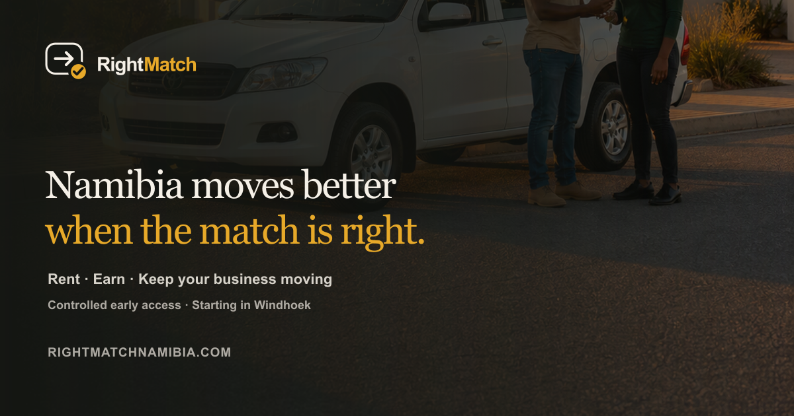
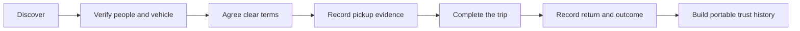
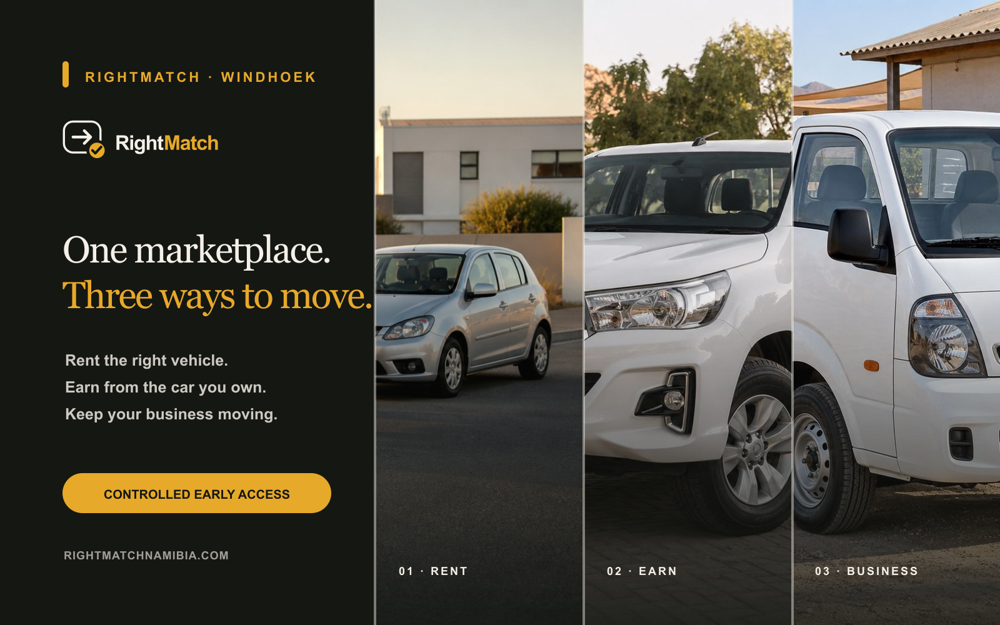
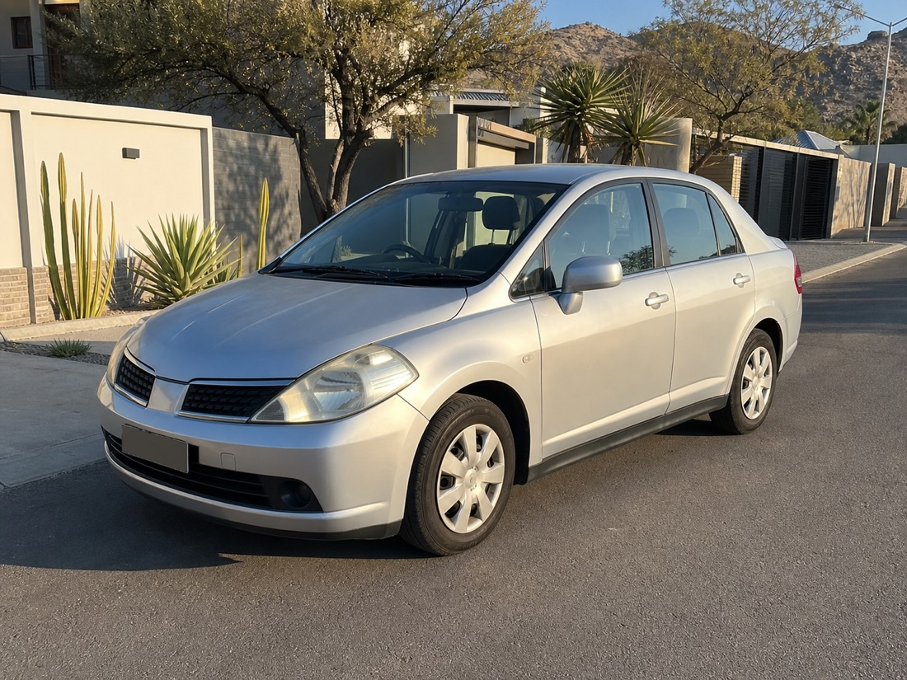
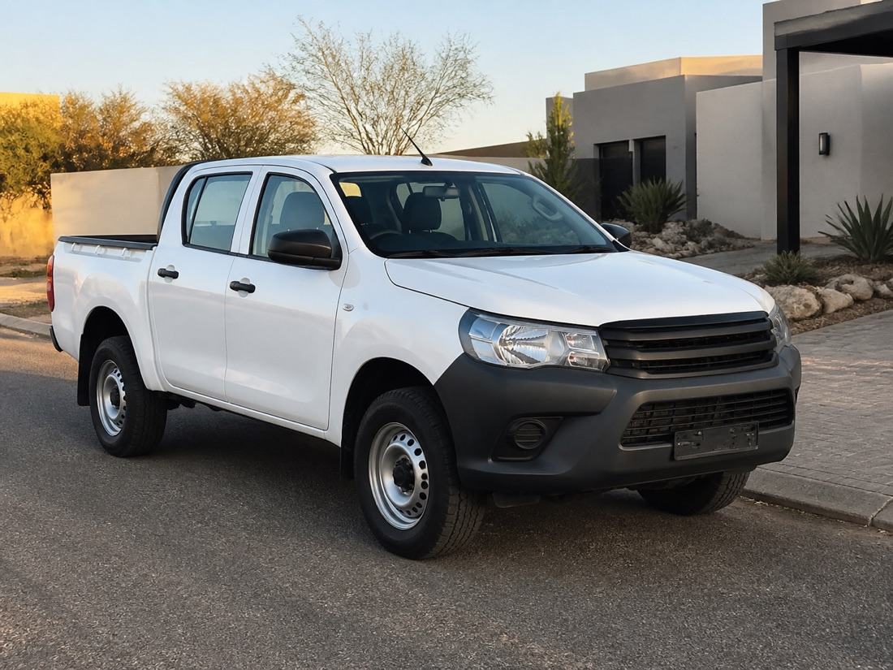

# RightMatch Namibia

**A trust-first peer-to-peer vehicle marketplace designed for Namibia.**

[Visit the live product](https://rightmatchnamibia.com) · [Contact RightMatch](mailto:info@rightmatchnamibia.com)

RightMatch helps vehicle owners turn underused cars into income while giving renters a clearer, safer way to find the right vehicle for the job. The product is built around a simple reality: risk cannot be eliminated from a vehicle transaction, but good verification, explicit terms and a dependable evidence trail can make every decision more informed.

> This is a public product case study. The production application, backend, infrastructure configuration and operational security controls remain in a separate private repository.

## My role

**Freeman Ipumbu — Product builder, design researcher and full-stack engineer**

I took RightMatch from the initial concept through research framing, product strategy, interaction design, brand refinement, frontend and backend engineering, trust architecture, production infrastructure and launch.

The project is being developed in partnership with **Johny Kahuva**, whose participation and shared product vision are acknowledged here. All design and implementation work presented in this case study was completed by Freeman Ipumbu.

## The challenge

Namibia has vehicles sitting idle while people and small businesses regularly need temporary access to practical transport. Informal rental arrangements can work, but they often rely on scattered messages, unclear expectations and limited recourse when memories differ.

RightMatch explores a more accountable model: help the right people find the right vehicles, verify meaningful claims, make responsibilities understandable and preserve a usable record of every completed step.

## The product response

- A purpose-led vehicle marketplace for errands, family use, deliveries, gig work and trade.
- A broader illustrative vehicle range spanning compact hatchbacks, sedans, bakkies, crossovers, panel vans, minibuses and road-trip-ready SUVs.
- Structured owner and vehicle onboarding with explicit information requirements.
- A Trust Passport that communicates useful verification signals without exposing private identity data.
- Clear owner–renter terms and prominent explanations of RightMatch's facilitator role.
- Guided pickup and return evidence covering condition, mileage and fuel.
- A deal ledger connecting identities, agreements, handover evidence and deposit outcomes.
- Fair-price guidance based on vehicle class, with deposits, mileage, cover and fees shown separately.
- Trust-based loyalty tiers that reward consistently responsible participation.
- Consent-backed early-access registration protected against automated abuse.
- A role-gated operations control room for verification, deal, support and incident oversight.
- Named executive access protected by multi-factor authentication and one-time recovery codes.
- Exportable management snapshots, registration sheets and attributable audit history.

## Design science approach

The work followed an iterative design science cycle:

1. **Problem framing** — identify the trust, access and accountability gaps in informal vehicle rental.
2. **Objectives** — create added peace of mind without pretending risk can be eliminated.
3. **Artefact design** — combine marketplace discovery with verification, consent and evidence mechanisms.
4. **Demonstration** — build realistic renter, owner and completed-deal journeys.
5. **Evaluation** — test clarity, responsiveness, failure states, data boundaries and production readiness.
6. **Iteration** — simplify language and interactions while strengthening the operational paper trail.

## Trust model

RightMatch is the platform and evidence layer. Each rental remains a direct agreement between the vehicle owner and renter. Verification improves information and accountability; it is never presented as a guarantee.

## Selected screens

The interface uses a restrained Namibian palette, warm editorial typography and focused interaction cues. The aim is to feel dependable and local without becoming institutional or visually heavy.

| Everyday mobility | Family flexibility | Work-ready vehicles |
|---|---|---|
|  |  |  |

| City and business use | Bakkie capability | Longer journeys |
|---|---|---|
|  |  |  |

All marketplace vehicle photographs shown in the public preview are original AI-generated demonstration assets. They are labelled as illustrative in the product and are never presented as a specific owner’s vehicle, evidence or live availability.

## Engineering overview

The production system uses a responsive React interface, an API service, relational persistence, private object storage, bot protection and a transactional-email outbox. Deployment, credentials, database design, internal endpoints and implementation source are intentionally omitted from this public repository.

The build includes:

- responsive and accessible interaction patterns;
- production-mode separation from fictional demonstration workflows;
- server-side validation and abuse controls;
- consent and lifecycle records;
- duplicate-safe, retryable transactional messages;
- private storage boundaries for future evidence uploads;
- named workforce access with enforced multi-factor authentication;
- tamper-evident operational history and spreadsheet-ready reporting;
- health checks, backup planning and operational readiness documentation.

## Current status

RightMatch Namibia is live as a controlled early-access preview. The upgraded homepage now provides dedicated owner and renter paths, a founder-led product story, a transparent owner-proceeds estimator, a Trust Centre preview and a wider Namibia-focused vehicle demonstration range. Public users can explore the product direction and register interest. Payments, live bookings and document submission remain gated until the corresponding legal, insurance, identity and operational safeguards are approved.

## Repository boundary

This repository intentionally contains no deployable application source. It excludes:

- production or private repository history;
- API and authentication implementation;
- infrastructure and provider configuration;
- database schemas and migrations;
- environment variables, credentials and internal identifiers;
- customer, pilot or analytics data.

Please report security concerns privately to [info@rightmatchnamibia.com](mailto:info@rightmatchnamibia.com), not through a public issue.

---

© 2026 RightMatch Namibia. Product concept and implementation documentation are shared for portfolio viewing. No licence is granted to reproduce the product, branding or documentation.
